# Li ZhenXi: portfolio site

A personal site that is itself a small production service. The front end shows the work; the
back end, the pipeline and the monitoring are the work.

**Live:** https://portfolio-emsghin2iq-as.a.run.app (Cloud Run, asia-southeast1)

- **Run like production:** an SLO measured from outside, a pipeline that holds or rolls back a bad release, postmortems, and this month's bill.
- **Things to try:** break it with real faults (`/break`), size a GPU for agents (`/research#capacity`), or debug the server in a Codespace.
- **The work behind it:** the two platforms I run at Primustech and my final-year research on serving LLM agents, a chapter each.

[](https://github.com/zhenxi0901/portfolio/actions/workflows/ci.yml)
[](https://github.com/zhenxi0901/portfolio/actions/workflows/deploy.yml)
[](https://portfolio-emsghin2iq-as.a.run.app/status)
[](https://scorecard.dev/viewer/?uri=github.com/zhenxi0901/portfolio)

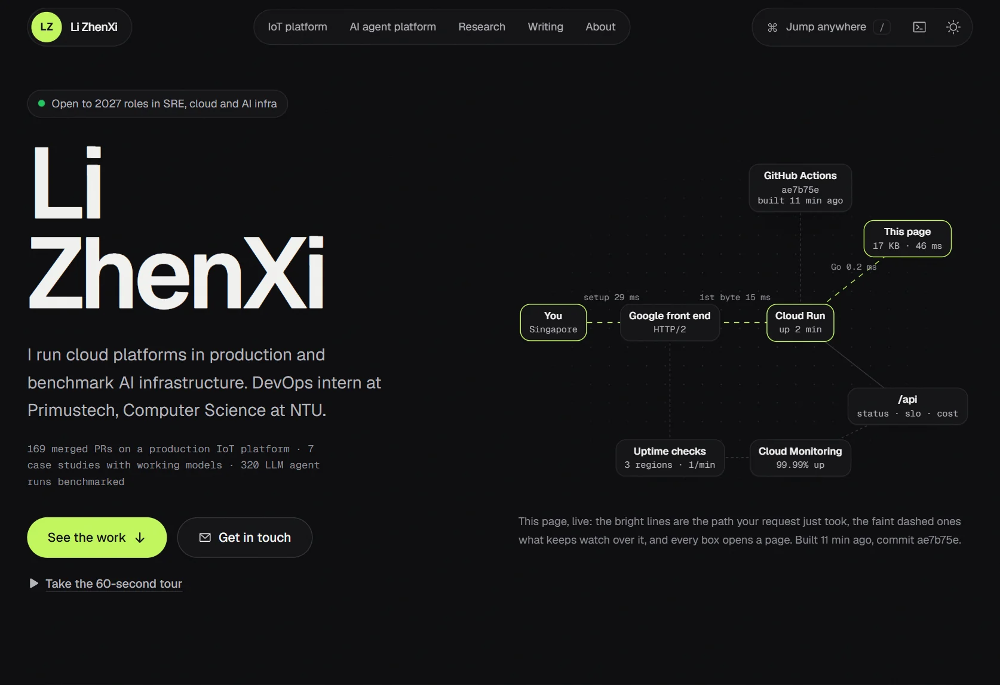

## What you will find on it

Three things I work on, each with a chapter of its own: the **building IoT platform** I run on GKE
(`/iot`) and the **AI agent platform** I run on Cloud Run (`/ai`), both at Primustech, and **ARIES agent
benchmarks**, my final-year project at NTU (`/research`). The home page is short on purpose: who I am,
what I am doing now, a card per chapter, and the ways into the site's own operations. Writing and
postmortems are at `/writing`, experience and the Ask console at `/about`, and the one-page version the
site used to be is kept at `/v1` ([ADR 11](docs/adr/0011-chapters-not-one-page.md)).

Three things to try against the live server: **break it yourself** (`/break`), which injects delays and 503s into your own
requests and lets four client strategies cope with them; **what it costs** (`/cost`), this month's bill from the service's own
meters at Google's list prices; and a **capacity lab** (`/research#capacity`) that sizes a GPU for long-running agents from my
FYP's numbers. Or debug this server yourself:

[](https://codespaces.new/zhenxi0901/portfolio?ref=drill/01&quickstart=1)

That opens the [break-fix drill](https://github.com/zhenxi0901/portfolio/tree/drill/01/drills/01) on the `drill/01` branch: this Go
server with one bug planted in it, real traffic, and a check that grades the fix (`make drill`, find it, `make check`).

| 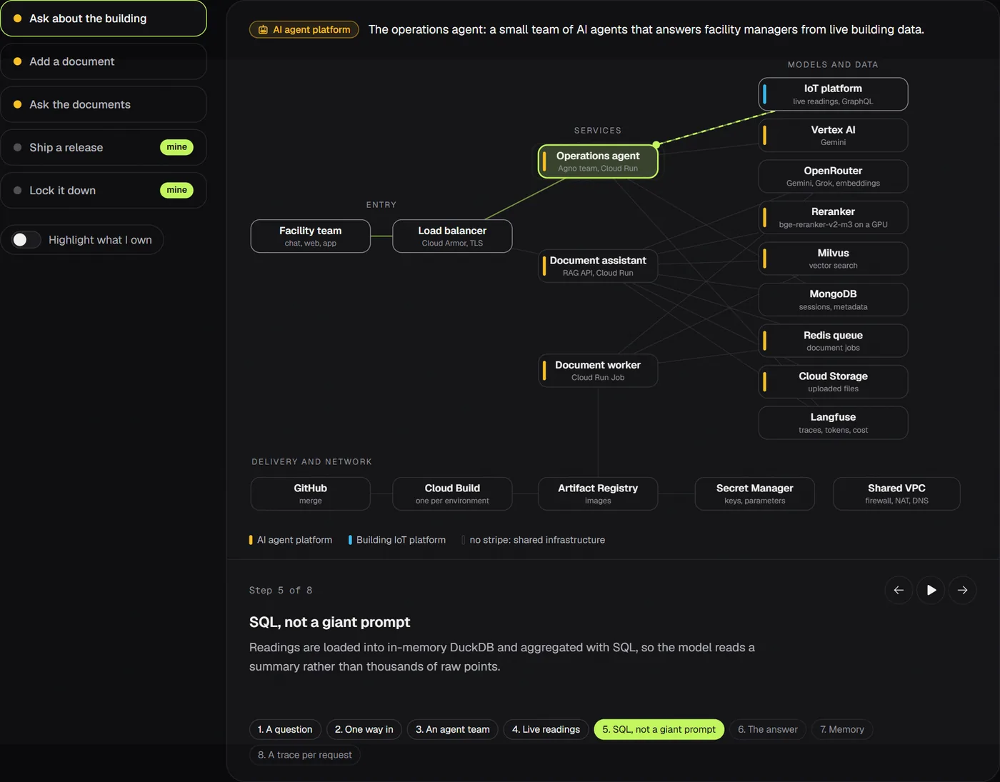 | 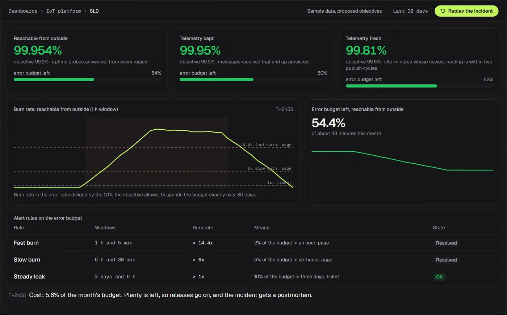 |
|---|---|
| **Follow a request** through the AI agent platform: agents, RAG, GPU reranker, models, traces, and which parts are mine. | **SLOs and error budgets** for the IoT platform, with multi-window burn-rate alerts and a replayable incident. |
| 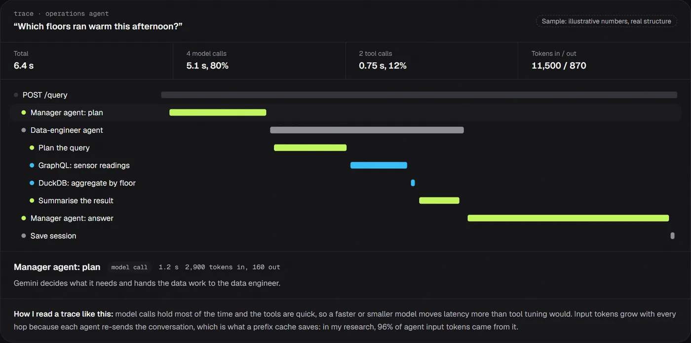 | 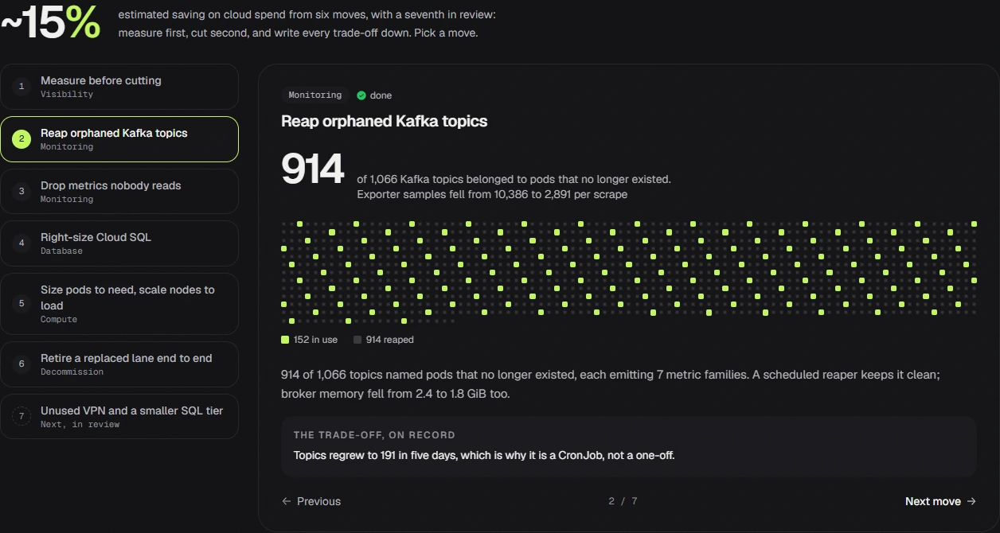 |
| **Inside one request**: where an agent answer's time and tokens go. | **Cost review**: an estimated 15% off cloud spend from six moves, with a seventh in review, each with its before and after and the trade-off on record. |
| [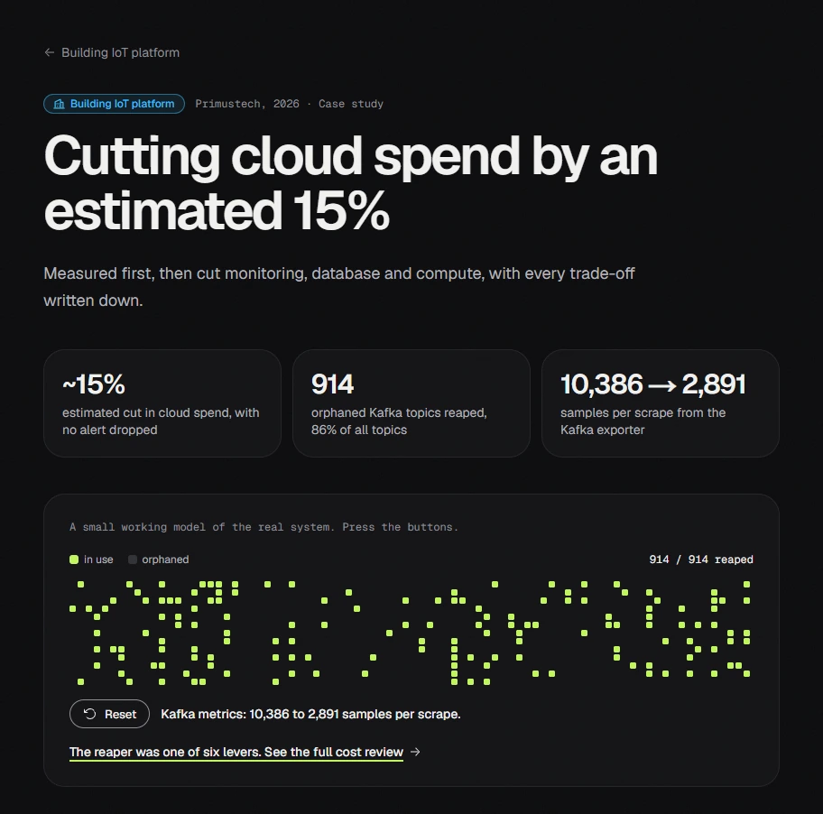](https://portfolio-emsghin2iq-as.a.run.app/work/reaper) | [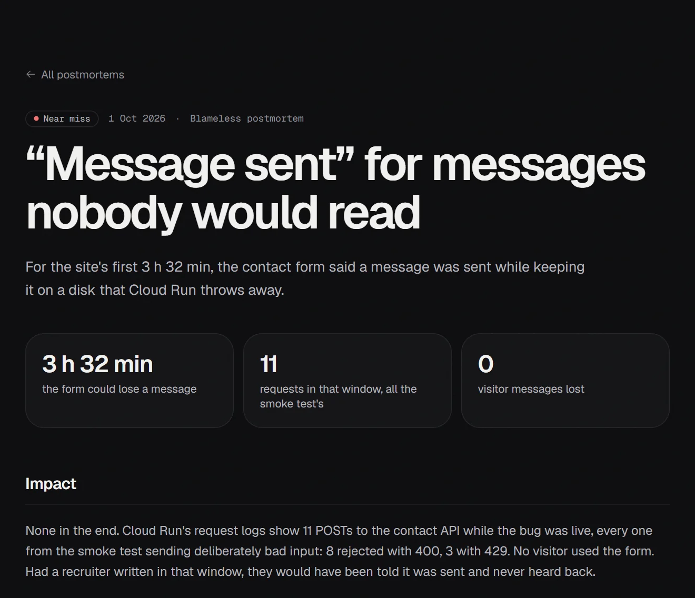](https://portfolio-emsghin2iq-as.a.run.app/postmortems/contact-form) |
| **A page per case study** (`/work/<case>`): the numbers, the same working model, the full write-up, and links into the deeper sections. | **Postmortems** (`/postmortems/<slug>`): blameless write-ups of what went wrong running this site, with times and counts from the commits, the CI history and Cloud Run's request logs. |
| [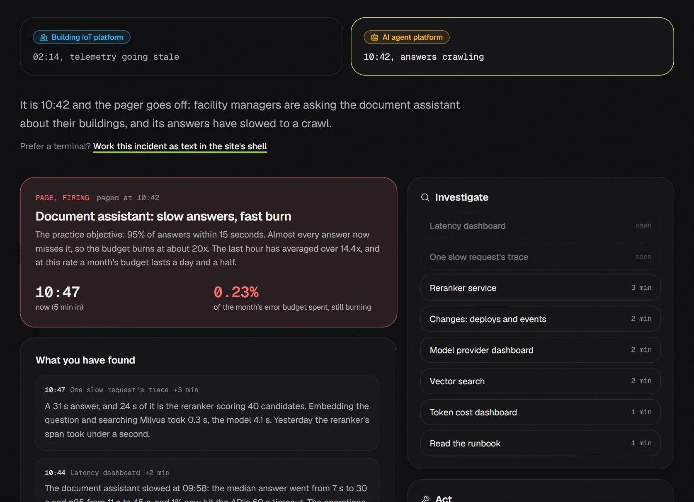](https://portfolio-emsghin2iq-as.a.run.app/oncall) | [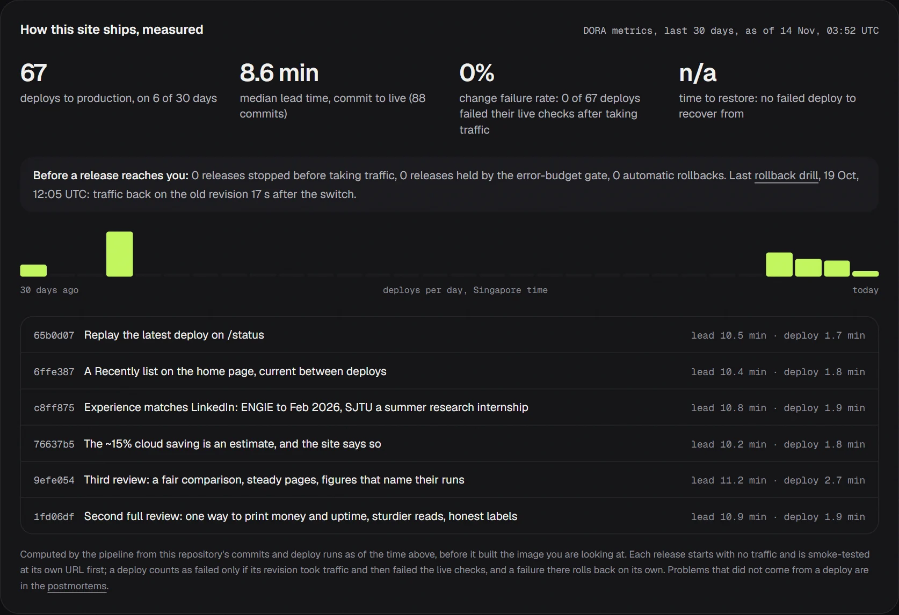](https://portfolio-emsghin2iq-as.a.run.app/status) |
| **Go on call** (`/oncall`): two simulated pages, stale telemetry on the IoT platform or slow answers on the AI agent platform. Every look and action costs minutes while the error budget burns, and you get a postmortem of your own response; the site's terminal runs them as text too (`oncall`). | **How this site ships**: DORA's four keys for this repository, computed by the pipeline from its own commits and deploy runs and baked into the image it deploys. |
| [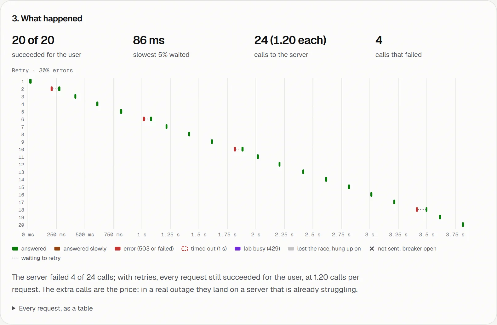](https://portfolio-emsghin2iq-as.a.run.app/break) | [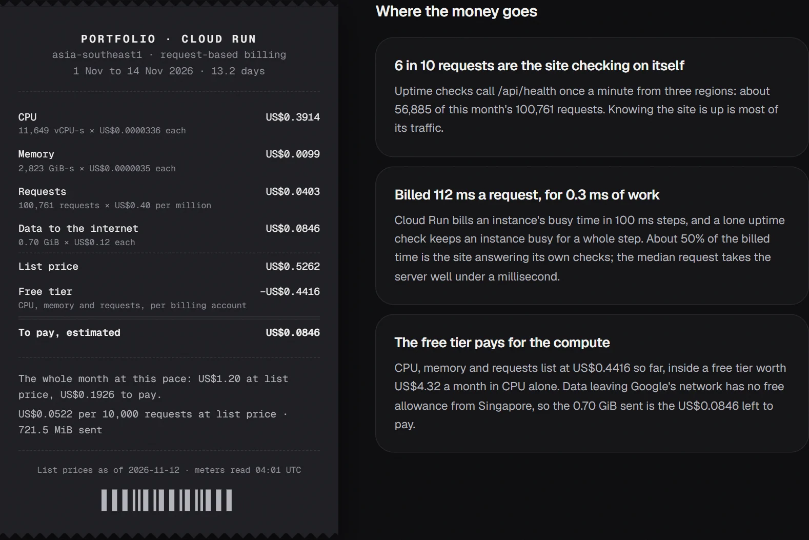](https://portfolio-emsghin2iq-as.a.run.app/cost) |
| **Break it yourself** (`/break`): delays and 503s injected into your own requests on the live server, and four clients against them: give up, retry with jittered backoff, a circuit breaker, hedging. | **What it costs** (`/cost`): the month so far as a receipt, from the service's own meters at list prices, with where the money goes, a what-if for a busy day, and what caps the bill. |
| [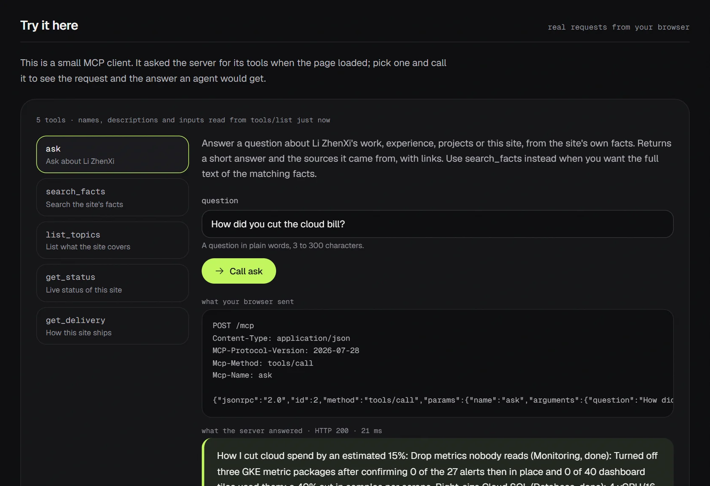](https://portfolio-emsghin2iq-as.a.run.app/agents) | [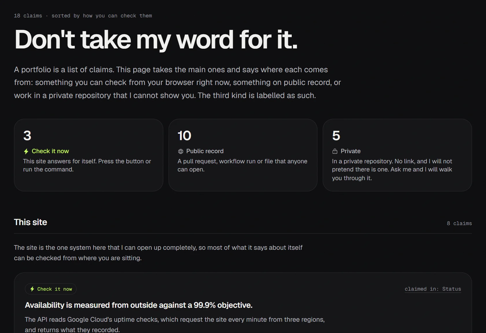](https://portfolio-emsghin2iq-as.a.run.app/evidence) |
| **Ask it with your own agent** (`/agents`): the site is an MCP server. Add one URL to Claude, Cursor or any MCP client, or call the tools from the console on the page. `curl` on the home page gets a text card. | **Evidence** (`/evidence`): every headline claim, sorted by whether you can check it live, on public record, or not at all because the work is private. |

```
Browser ──> Cloud Run: one Go binary ──> Next.js static export  (/, /_next/*, /work/*, /oncall, ...)
                                    ├──> JSON API               (/api/status, /api/slo, /api/cost, /api/ask, /api/lab/echo, /api/contact, /api/badge/uptime, /api/card.svg, /api/map.svg)
                                    ├──> MCP server             (/mcp: five read-only tools for AI agents)
                                    ├──> plain text             (/llms.txt, /md/*.md; a text card when the home page is asked for with curl)
                                    ├──> OpenTelemetry spans    (/api/ask) ──> Cloud Trace
                                    └──> Prometheus metrics     (/metrics) ──> Prometheus ──> Grafana (local stack)
Cloud Monitoring uptime checks, 3 regions ──> /api/health; /api/slo reads them back as the site's SLO

CI:     lint, typecheck, tests, parity ──> build image once ──> smoke, Lighthouse, CVE gate ──> push, attest SBOM + provenance
Deploy: find that digest ──> verify attestations ──> error-budget gate ──> new revision, no traffic ──> smoke test it
        ──> traffic to it ──> smoke test live ──> (fails?) traffic back to the previous revision ──> GitHub release
Terraform ──> Cloud Run, Artifact Registry, Secret Manager, uptime check, keyless GitHub OIDC deploys
```

## What is in it

| Area | Highlights |
|---|---|
| **Front end** (`web/`) | Next.js 16, React 19, Tailwind CSS v4, Motion, three.js via react-three-fiber. A hero that maps the visitor's own request live (connection setup, first byte and time in Go from the page's own timing, the instance and commit that answered, the uptime checks and SLO watching it), as a list on phones; the 3D "service mesh" hero it replaced is kept on `/v1`; seven playable case studies (pipeline gates with an approval step, a Kafka topic reaper, a ZooKeeper quorum alert, GKE pod and node autoscaling across zones, a remote-control lane with its safety guards, a cache password rolled out in two steps, an agent request's path through the AI platform); **Inside the IoT platform** (hop-by-hop traffic paths and tunnels; SLIs, SLOs and error budgets on a Grafana-style board with a replayable incident; a cause-alert playground for eight failure modes; the investigation route and runbook; a seven-move cost review); **the AI agent platform** (an animated system map with five request journeys and a "what I own" lens, the AI infrastructure stack layer by layer, a Langfuse-style request trace, what I measure on an LLM service); **research** (FYP charts, where an agent's time goes and what each MCP server costs per call, a prefix-cache explainer, the GPU-over-SSH setup, the Apptainer backend that runs the stack on a supercomputer without root); a page per case study, three postmortems from running this site and three longer write-ups (`/writing/<slug>`), each with its own generated share card, and a sitemap; an **on-call drill** (`/oncall`) that scores a simulated incident response and writes its postmortem; **break it yourself** (`/break`), fault injection on the live server with four client strategies drawn attempt by attempt; **what it costs** (`/cost`), a receipt from the service's own meters with a what-if for traffic spikes; a **capacity lab** in the research chapter for serving agents on one GPU; a 60-second guided tour (`/?tour`); the site's own SLO and DORA metrics in the status section; a **status page** (`/status`) with live state, 30-day availability, how the site is watched, the incident history and an Atom feed; a **changelog** (`/changelog`) of every release and the commits it shipped, written by the pipeline; eleven **architecture decision records** (`/decisions`, also in `docs/adr`); an **evidence** page (`/evidence`) that sorts the site's claims by whether you can check them live, on public record, or not at all because the work is private; a page **for agents** (`/agents`) with a console that sends real MCP requests, `/llms.txt`, and a Markdown copy of every case study, write-up and postmortem under `/md/`; a trace of the visitor's own page load, and of each Ask answer; a **terminal** (press `` ` ``, or `/?terminal`): a shell in the page whose commands (`status`, `slo`, `cost`, `deploys`, `ask`, `mcp`, `curl`, `cat work/gke.md`) all read the live API, with tab completion and history, loaded only when first opened; a ⌘K command palette that searches by topic and reaches every page; dock navigation; light and dark themes. Content renders without JavaScript; motion respects `prefers-reduced-motion`. |
| **Back end** (`api/`) | Go 1.27, standard library `net/http`. Serves the static export with immutable caching and build-time brotli/gzip (no per-request compression CPU), plus `/api/status` (live uptime and latency percentiles), `/api/slo` (this site's own availability and error budget, read from Cloud Monitoring with the metadata server's token, standard library only), `/api/cost` (this month's usage from Cloud Monitoring, priced at list prices, read at most hourly), `/api/lab/echo` (the delays and 503s a visitor asks for, on their own requests only, capped and rate limited, kept out of the SLO and the live latency), `/api/ask` (BM25 retrieval over the site's own facts, optional LLM on top, cached, rate limited, prompt-injection fenced; traced with OpenTelemetry, exported to Cloud Trace by a small REST exporter, and each answer carries its own trace), `/api/contact` (validation, honeypot, rate limit, delivery to a Discord or Slack webhook before the visitor is told it was sent), `/api/badge/uptime` (a shields.io endpoint for the uptime badge: the 30-day window, or the time since measuring began until it fills), `/api/card.svg` (the live card on my GitHub profile: commit, uptime, error budget, release policy and DORA numbers, drawn by the server itself in light and dark; `/api/card.txt` is the same card as text, and `curl` on the home page gets it instead of HTML), `/api/map.svg` (an animated map of the site's own request path with this instance's live numbers, also for the profile), and `/mcp`: the site as a **Model Context Protocol server** with five read-only tools (`ask`, `search_facts`, `list_topics`, `get_status`, `get_delivery`) over the same facts and live numbers, stateless, speaking the 2026-07-28 revision and the older handshake, with no SDK and no model of its own. `Server-Timing` on every response (server time, Cloud Run revision, and process age on an instance's first visitor request, which the page uses to say "you woke this server up"). CSP and security headers, request IDs, structured logs, graceful shutdown. |
| **Reliability** | A real SLO for the site itself: 99.9% over 30 days, measured by Google Cloud uptime checks every minute from three continents and shown on the page with the error budget left. For the local stack: Prometheus metrics with bounded route labels, recording rules for a 99.5% request SLO, a fast-burn alert that needs both the last hour and the last 5 minutes above 14.4x, latency and abuse alerts (`deploy/prometheus/rules.yml`), and a provisioned Grafana dashboard (`deploy/grafana`). |
| **Delivery** | Multi-stage Dockerfile to a 30 MB distroless, non-root image. GitHub Actions: lint, typecheck, build, `go vet`, race-detector tests, a TypeScript/Go parity check, container smoke test, Lighthouse budgets and a CRITICAL-CVE gate, with every action pinned to a commit SHA. The image is built once: CI pushes it only after every check passes and attests its SBOM and build provenance. The deploy refuses an image whose attestations don't verify, holds the release if the site's own error budget is spent (unless the commit is marked `Reliability-fix:`), starts the new revision with no traffic and smoke-tests it at its own URL, then moves traffic and checks again, rolling back to the previous revision on its own if that fails; a manual **rollback drill** rehearses exactly that in production. Every release becomes a GitHub release with its SBOM and provenance attached. Keyless via Workload Identity Federation; only pushes to `main` in this repository deploy, never a fork's pull request. The production image's base images pinned by digest, Dependabot for updates, CodeQL and OpenSSF Scorecard on every push to `main`, Go fuzz tests for the inputs visitors control. |
| **Infrastructure** (`infra/`) | Terraform for Cloud Run (scale to zero, probes, least-privilege runtime identity), Artifact Registry with cleanup policies, Secret Manager for the contact webhook and the optional LLM key, the uptime check behind the SLO (`infra/slo.tf`), Cloud Trace write access for the runtime identity (`infra/tracing.tf`), a read-only identity for the scheduled contact checks (`infra/watch.tf`), and a GitHub OIDC pool limited to this repository's `main` branch. |

Why it is built this way, and what each choice costs, is in the [architecture decision records](docs/adr/README.md).

Every number on the site traces to the CV, Primustech's PR history, the platforms' own docs or the FYP report.
Where the site shows sample data (the SLO board, whose objectives are still proposals, and the request trace),
the page says so. Content lives in `web/src/content/` (`profile.ts`, `products.ts`, `ai-platform.ts`, `slo.ts`, `postmortems.ts`,
`oncall.ts`, `writing.ts`), and `/knowledge.json`, which the Ask console reads, is generated from it at build time.

## Run it

```bash
# Front end only, hot reload (the API widgets fall back gracefully)
cd web && npm install && npm run dev

# The whole thing, production-like: site :8080, Prometheus :9090, Grafana :3001
docker compose up --build
./scripts/smoke.sh http://localhost:8080
./scripts/loadtest.sh http://localhost:8080 2000 32

# API tests in the same Go toolchain as CI, no local Go needed
./api/scripts/test-in-docker.sh
```

### Test results (30 Sep 2026, with the smoke test as it was then)

| Where | Smoke test | Load test (2,000 requests per endpoint, 32 concurrent) | Server-side p99 |
|---|---|---|---|
| Laptop, Docker Compose | 13/13 | ~2,000 req/s per endpoint, 0 errors, client p99 under 6 ms | 0.11 ms |
| GCP VM (n2-standard-8, asia-southeast1) | 13/13 | ~1,000 req/s per endpoint, 0 errors, client p99 under 6 ms | 0.07 ms |

The load generator (one `curl` per request) is the bottleneck in both runs; the server answers in
microseconds. The Ask rate limiter let exactly the per-minute budget through and returned 429 for
the rest.

Browser end-to-end tests against the live site (13 Nov 2026, after a full re-review): all 27 pages
in the sitemap at desktop and phone widths with no dead links or horizontal overflow, axe (WCAG 2.2 AA
and best practice) clean in both themes, and no console warnings or errors; plus suites for
**break it yourself** (25 checks, real faults against the live server: the arrival schedule, each
client strategy, the comparison, the phone timeline), **what it costs** (25: the receipt adding up,
the what-if at this month's pace matching it to the cent, the fallbacks), the **capacity lab** (17),
the **live-map hero** (15: the edge timings, polling only while on screen), the chapters and the
earlier review fixes. The deploy pipeline runs `scripts/smoke.sh` against the new revision and the
live URL on every release, and CI holds each release to accessibility and SEO of 100 on a page of
every kind (and the home and status pages in dark).

To use the API while running `next dev`, start the container and run the dev server with
`NEXT_PUBLIC_API_BASE=http://localhost:8080` and the container with `ALLOWED_ORIGINS=http://localhost:3000`.

### Optional: an LLM behind the Ask console

Any OpenAI-compatible endpoint works (OpenAI, OpenRouter, DeepSeek, Vertex AI's compatible surface, or a self-hosted SGLang/vLLM server):

```bash
LLM_BASE_URL=https://api.deepseek.com LLM_API_KEY=... LLM_MODEL=deepseek-chat docker compose up
```

Without it, the console answers with retrieval alone, and if the API is unreachable the browser answers from the same facts.

## Deploy to Cloud Run

```bash
cd infra
cp example.tfvars terraform.tfvars   # fill in; ignored by git
terraform init
terraform apply
# then, from `terraform output`, set repository variables GCP_REGION and WIF_PROVIDER, and repository
# secrets GCP_PROJECT and DEPLOYER_SA (secrets, so the public Actions logs mask them)
```

On a push to `main`, CI builds the image once, tests it, and pushes and attests it only if every check passes
(`.github/workflows/ci.yml`). The deploy (`.github/workflows/deploy.yml`) then releases that exact digest:
it verifies the attestations, applies the error-budget gate (`scripts/budget-gate.sh`), starts the revision
with no traffic, runs `scripts/smoke.sh` against its tagged URL, moves traffic, runs the smoke test against
the live URL, and rolls back if that fails. A manual run releases `main`'s head only if CI has already pushed
a tested image for it; tick **rollback drill** to rehearse the rollback, or give an override reason to release
while the budget is spent. Because the pipeline pins traffic to the revision it checked, a Terraform change to
the service goes live with the next release.

### Contact form messages

On Cloud Run the container's disk is scratch space, so messages are delivered to a Discord (or Slack) webhook
before the visitor is told they were sent; if delivery fails, the form asks them to email instead. On Cloud Run
a missing webhook is refused outright (503) rather than reported as sent; set `CONTACT_REQUIRE_WEBHOOK=false`
to opt out. Why: see the contact-form postmortem on the site. Terraform
creates an empty `portfolio-contact-webhook` secret. Add the webhook URL as a version (it is read from the
terminal, so it never lands in shell history or Terraform state), then turn forwarding on:

```bash
read -rsp "Webhook URL: " URL && printf %s "$URL" | gcloud secrets versions add portfolio-contact-webhook --data-file=- && unset URL
# set enable_contact_webhook = true in terraform.tfvars, then
terraform apply
```

Two scheduled checks keep watching it (`.github/workflows/synthetic.yml`, identity in `infra/watch.tf`): hourly,
Cloud Run's logs are searched for `contact: undelivered` since the previous search, and twice a day a message
marked by a secret token goes through the live form and the real webhook. A marked message is posted silently
and never stored. GitHub can start scheduled runs late, sometimes by hours; because each search starts where the
last one stopped, a late run delays an alert but misses nothing.
A failure fails the workflow, which GitHub emails about. To set up the token, one value in two places:

```bash
TOKEN=$(openssl rand -hex 32)
printf %s "$TOKEN" | gcloud secrets versions add portfolio-contact-synthetic-token --data-file=-
printf %s "$TOKEN" | gh secret set CONTACT_SYNTHETIC_TOKEN && unset TOKEN
terraform output -raw watcher_sa | gh secret set WATCHER_SA
# set enable_synthetic_check = true in terraform.tfvars, then terraform apply; it goes live with the next release
```

## Editing content

Change the files in `web/src/content/`, then regenerate the Go test fixtures and the decision records so
CI's checks pass:

```bash
cd web && npm run build && node scripts/gen-parity.mts && cp out/knowledge.json ../api/internal/ask/testdata/
node scripts/gen-adr.mts   # after editing decisions.ts: rewrites docs/adr
```

`src/content/generated/` holds the pipeline's snapshots (`delivery.json`, `changelog.json`); CI rewrites them
before each build, and `GITHUB_TOKEN=$(gh auth token) node scripts/delivery-stats.mjs` refreshes them by hand.

## Credits

Design direction informed by [Taste Skill](https://github.com/Leonxlnx/taste-skill), [Magic UI](https://github.com/magicuidesign/magicui) and its [portfolio](https://github.com/magicuidesign/portfolio), and editorial layouts from [Jiro](https://jiro.build). Built with [Next.js](https://github.com/vercel/next.js), [Tailwind CSS](https://github.com/tailwindlabs/tailwindcss), [shadcn/ui](https://github.com/shadcn-ui/ui) patterns, [Motion](https://github.com/motiondivision/motion), [three.js](https://github.com/mrdoob/three.js), [react-three-fiber](https://github.com/pmndrs/react-three-fiber), [Phosphor Icons](https://github.com/phosphor-icons/react), [Simple Icons](https://github.com/simple-icons/simple-icons) and [cmdk](https://github.com/dip/cmdk). All code here is original.

## Licence

The code is under the [MIT licence](LICENSE). The written content (`web/src/content/`, the case studies,
postmortems and posts) and the images are © Li ZhenXi and not covered by it. The Geist fonts used for the
share cards are under the SIL Open Font License.
