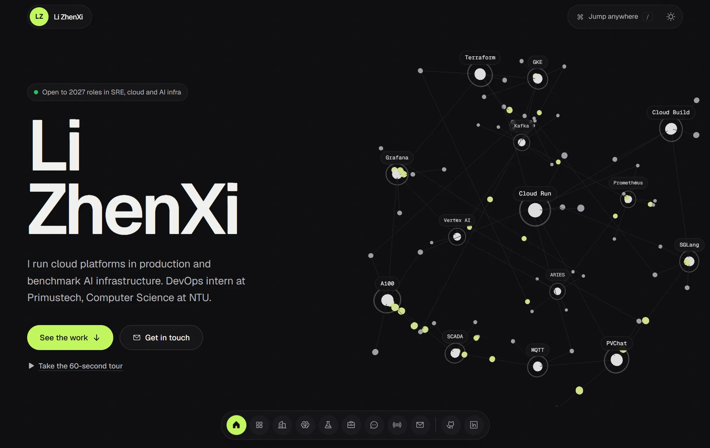
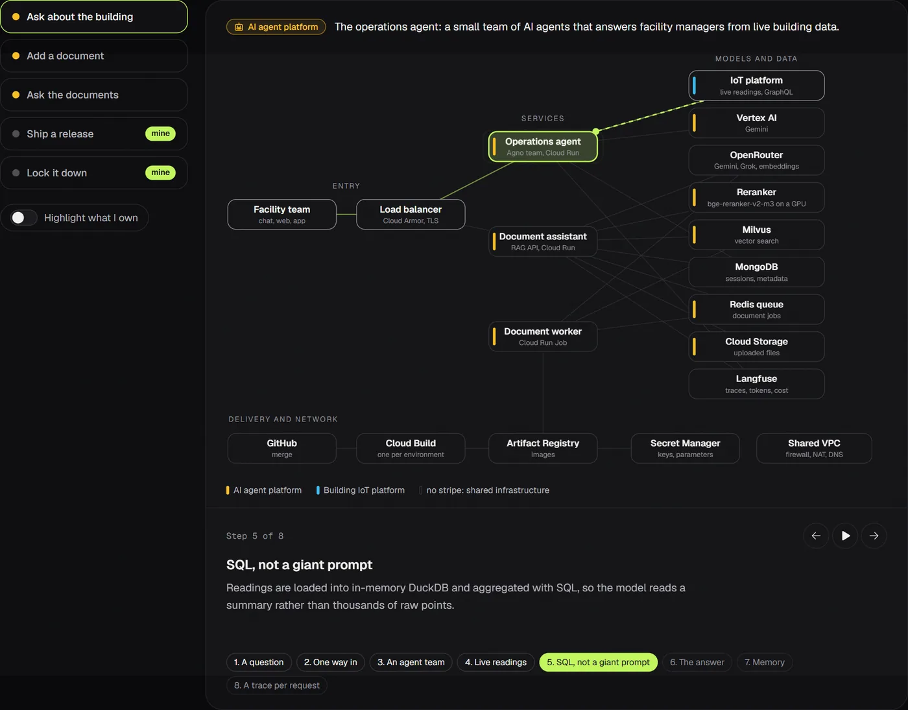
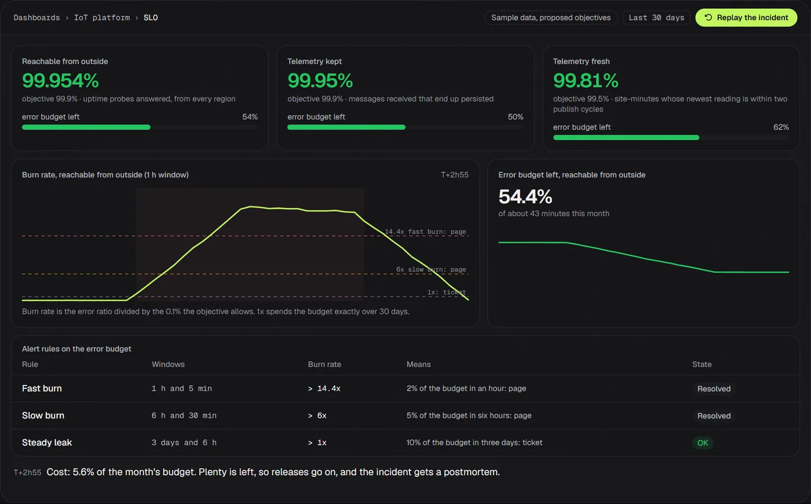
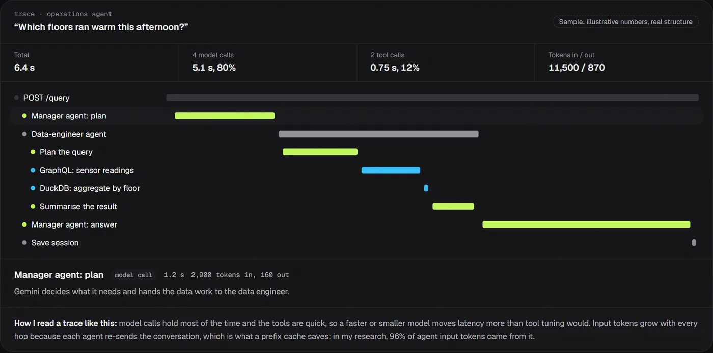
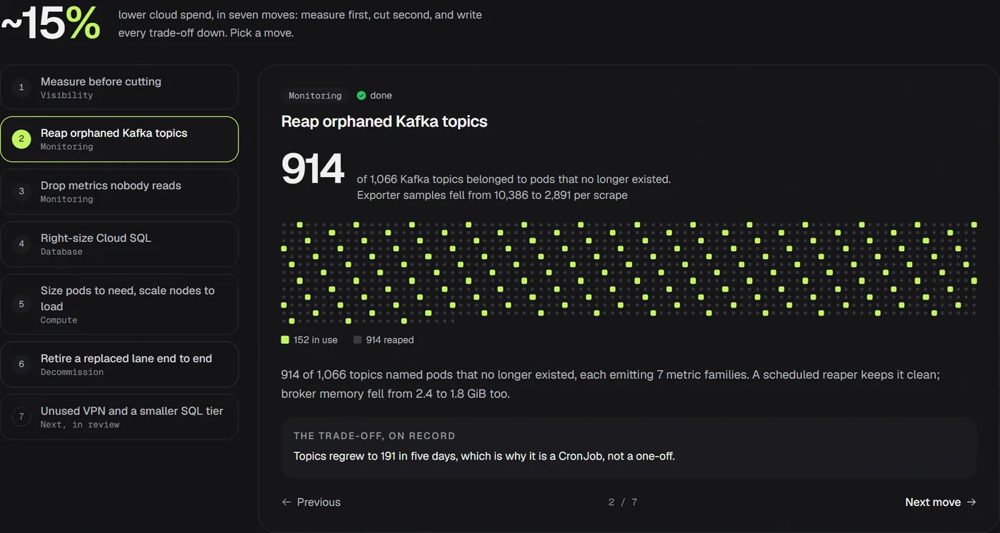
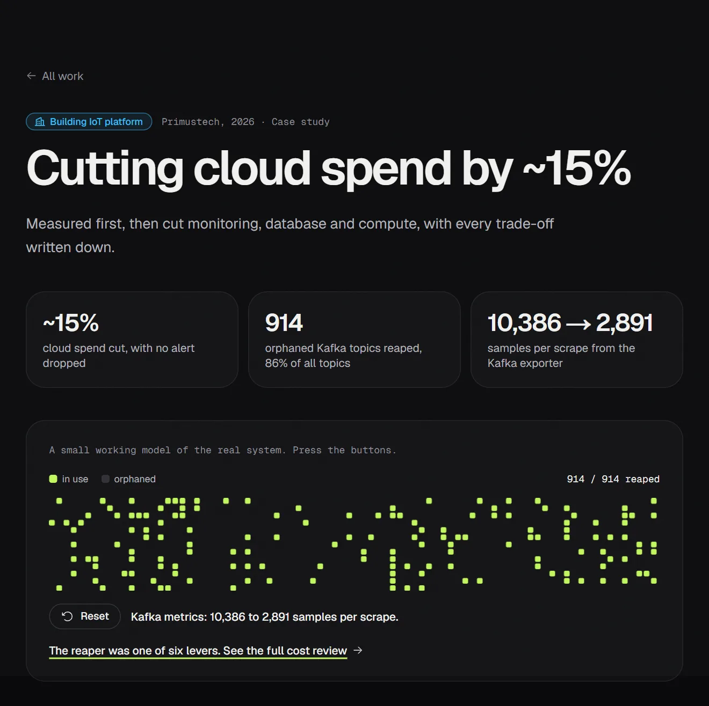
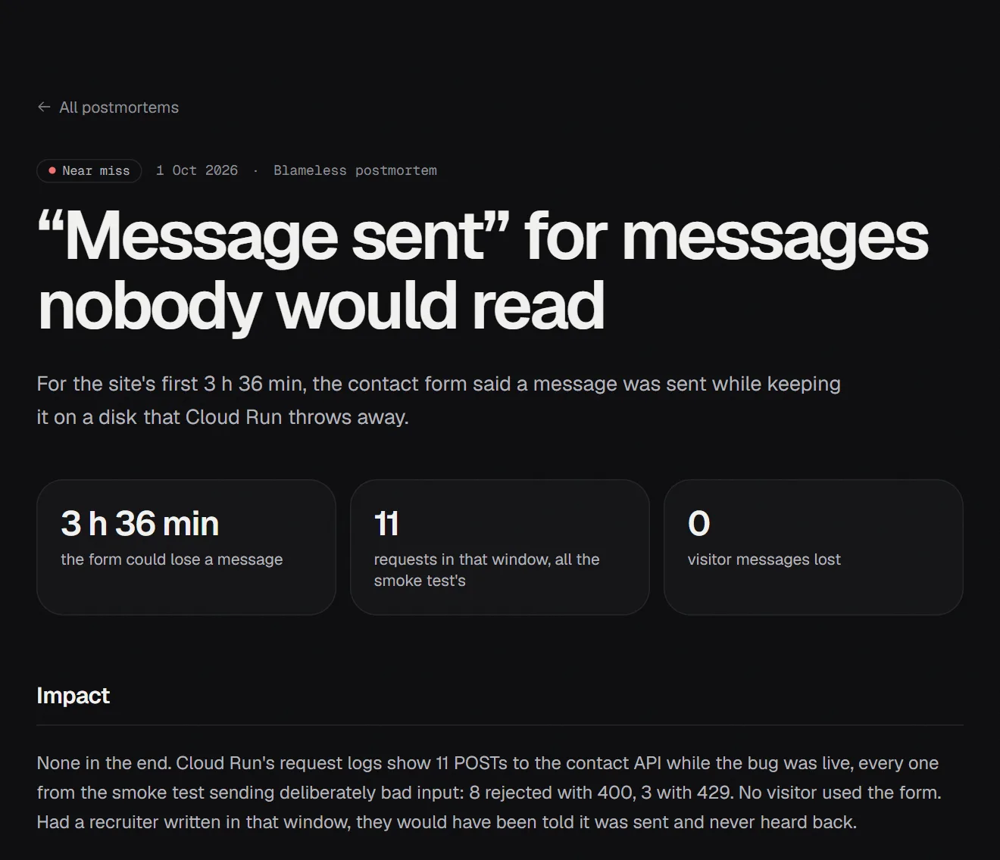

# Li ZhenXi: portfolio site

A personal site that is itself a small production service. The front end shows the work; the
back end, the pipeline and the monitoring are the work.

**Live:** https://portfolio-emsghin2iq-as.a.run.app (Cloud Run, asia-southeast1)



## What you will find on it

Three things I work on, each with its own colour on the page: the **building IoT platform** I run on GKE
and the **AI agent platform** I run on Cloud Run (both at Primustech), and **ARIES agent benchmarks**, my
final-year project at NTU.

| | |
|---|---|
|  |  |
| **Follow a request** through the AI agent platform: agents, RAG, GPU reranker, models, traces, and which parts are mine. | **SLOs and error budgets** for the IoT platform, with multi-window burn-rate alerts and a replayable incident. |
|  |  |
| **Inside one request**: where an agent answer's time and tokens go. | **Cost review**: a ~15% cut in seven moves, each with its before and after and the trade-off on record. |
| [](https://portfolio-emsghin2iq-as.a.run.app/work/reaper) | [](https://portfolio-emsghin2iq-as.a.run.app/postmortems/contact-form) |
| **A page per case study** (`/work/<case>`): the numbers, the same working model, the full write-up, and links into the deeper sections. | **Postmortems** (`/postmortems/<slug>`): blameless write-ups of what went wrong running this site, with times and counts from the commits, the CI history and Cloud Run's request logs. |

```
Browser ──> Cloud Run: one Go binary ──> Next.js static export  (/, /_next/*, /img/*)
                                    └──> JSON API               (/api/status, /api/ask, /api/contact)
                                    └──> Prometheus metrics     (/metrics) ──> Prometheus ──> Grafana
GitHub Actions ──> tests, image build, CVE gate ──> Artifact Registry ──> Cloud Run (by digest)
Terraform ──> Cloud Run, Artifact Registry, Secret Manager, keyless GitHub OIDC deploys
```

## What is in it

| Area | Highlights |
|---|---|
| **Front end** (`web/`) | Next.js 16, React 19, Tailwind CSS v4, Motion, three.js via react-three-fiber. An interactive 3D "service mesh" hero, loaded only on screens 768 px and wider once the browser is idle, with a static version for phones (Lighthouse on a phone profile: performance 90+, accessibility 100); five playable case studies (pipeline gates with an approval step, a Kafka topic reaper, a ZooKeeper quorum alert, GKE pod and node autoscaling across zones); **Inside the IoT platform** (hop-by-hop traffic paths and tunnels; SLIs, SLOs and error budgets on a Grafana-style board with a replayable incident; a cause-alert playground for eight failure modes; the investigation route and runbook; a seven-move cost review); **the AI agent platform** (an animated system map with five request journeys and a "what I own" lens, the AI infrastructure stack layer by layer, a Langfuse-style request trace, what I measure on an LLM service); **research** (FYP charts, a prefix-cache explainer, the GPU-over-SSH setup); a page per case study, three postmortems from running this site and two longer write-ups (`/writing/<slug>`), each with its own generated share card, and a sitemap; a trace of the visitor's own page load; a ⌘K command palette that searches by topic and reaches every page; dock navigation; light and dark themes. Content renders without JavaScript; motion respects `prefers-reduced-motion`. |
| **Back end** (`api/`) | Go 1.27, standard library `net/http`. Serves the static export with immutable caching and build-time brotli/gzip (no per-request compression CPU), plus `/api/status` (live uptime and latency percentiles), `/api/slo` (this site's own availability and error budget, read from Cloud Monitoring with the metadata server's token, standard library only), `/api/ask` (BM25 retrieval over the site's own facts, optional LLM on top, cached, rate limited, prompt-injection fenced), `/api/contact` (validation, honeypot, rate limit, delivery to a Discord or Slack webhook before the visitor is told it was sent). `Server-Timing` on every response (server time, Cloud Run revision, and process age on an instance's first visitor request, which the page uses to say "you woke this server up"). CSP and security headers, request IDs, structured logs, graceful shutdown. |
| **Reliability** | A real SLO for the site itself: 99.9% over 30 days, measured by Google Cloud uptime checks every minute from three continents and shown on the page with the error budget left. Prometheus metrics with bounded route labels, SLO recording rules and multi-window burn-rate alerts (`deploy/prometheus/rules.yml`), a provisioned Grafana dashboard (`deploy/grafana`). |
| **Delivery** | Multi-stage Dockerfile to a 30 MB distroless, non-root image. GitHub Actions: lint, typecheck, build, `go vet`, race-detector tests, a TypeScript/Go parity check, container smoke test and a CRITICAL-CVE gate. Deploys promote the exact image digest, keyless via Workload Identity Federation. |
| **Infrastructure** (`infra/`) | Terraform for Cloud Run (scale to zero, probes, least-privilege runtime identity), Artifact Registry with cleanup policies, Secret Manager for the contact webhook and the optional LLM key, the uptime check behind the SLO (`infra/slo.tf`), and a GitHub OIDC pool limited to this repository's `main` branch. |

Every number on the site traces to the CV, Primustech's PR history, the platforms' own docs or the FYP report.
Where the site shows sample data (the SLO board, whose objectives are still proposals, and the request trace),
the page says so. Content lives in `web/src/content/` (`profile.ts`, `products.ts`, `ai-platform.ts`, `slo.ts`, `postmortems.ts`), and
`/knowledge.json`, which the Ask console reads, is generated from it at build time.

## Run it

```bash
# Front end only, hot reload (the API widgets fall back gracefully)
cd web && npm install && npm run dev

# The whole thing, production-like: site :8080, Prometheus :9090, Grafana :3001
docker compose up --build
./scripts/smoke.sh http://localhost:8080
./scripts/loadtest.sh http://localhost:8080 2000 32

# API tests in the same Go toolchain as CI, no local Go needed
./api/scripts/test-in-docker.sh
```

### Test results (30 Sep 2026)

| Where | Smoke test | Load test (2,000 requests per endpoint, 32 concurrent) | Server-side p99 |
|---|---|---|---|
| Laptop, Docker Compose | 13/13 | ~2,000 req/s per endpoint, 0 errors, client p99 under 6 ms | 0.11 ms |
| GCP VM (n2-standard-8, asia-southeast1) | 13/13 | ~1,000 req/s per endpoint, 0 errors, client p99 under 6 ms | 0.07 ms |

The load generator (one `curl` per request) is the bottleneck in both runs; the server answers in
microseconds. The Ask rate limiter let exactly the per-minute budget through and returned 429 for
the rest.

Browser end-to-end tests against the live site (15 Oct 2026): 67 checks in three passes (desktop dark,
desktop light, phone), covering every section, tab and journey, the SLO incident, all eight failure
modes, all seven cost moves, the case dialogs, the Ask console, the visit trace, the command palette,
the dock and the 404 page. No crashes, console errors, failed requests or horizontal
overflow. The deploy pipeline also runs `scripts/smoke.sh` against the live URL after every release.

To use the API while running `next dev`, start the container and run the dev server with
`NEXT_PUBLIC_API_BASE=http://localhost:8080` and the container with `ALLOWED_ORIGINS=http://localhost:3000`.

### Optional: an LLM behind the Ask console

Any OpenAI-compatible endpoint works (OpenAI, OpenRouter, DeepSeek, Vertex AI's compatible surface, or a self-hosted SGLang/vLLM server):

```bash
LLM_BASE_URL=https://api.deepseek.com LLM_API_KEY=... LLM_MODEL=deepseek-chat docker compose up
```

Without it, the console answers with retrieval alone, and if the API is unreachable the browser answers from the same facts.

## Deploy to Cloud Run

```bash
cd infra
cp example.tfvars terraform.tfvars   # fill in; ignored by git
terraform init
terraform apply
# then set repository variables GCP_PROJECT, GCP_REGION, WIF_PROVIDER, DEPLOYER_SA from `terraform output`
```

Pushes to `main` that pass CI build, push and deploy automatically (`.github/workflows/deploy.yml`), and the
deploy finishes by running `scripts/smoke.sh` against the live URL.

### Contact form messages

On Cloud Run the container's disk is scratch space, so messages are delivered to a Discord (or Slack) webhook
before the visitor is told they were sent; if delivery fails, the form asks them to email instead. On Cloud Run
a missing webhook is refused outright (503) rather than reported as sent; set `CONTACT_REQUIRE_WEBHOOK=false`
to opt out. Why: see the contact-form postmortem on the site. Terraform
creates an empty `portfolio-contact-webhook` secret. Add the webhook URL as a version (it is read from the
terminal, so it never lands in shell history or Terraform state), then turn forwarding on:

```bash
read -rsp "Webhook URL: " URL && printf %s "$URL" | gcloud secrets versions add portfolio-contact-webhook --data-file=- && unset URL
# set enable_contact_webhook = true in terraform.tfvars, then
terraform apply
```

## Editing content

Change the files in `web/src/content/`, then regenerate the Go test fixtures so CI's parity check passes:

```bash
cd web && npm run build && node scripts/gen-parity.mts && cp out/knowledge.json ../api/internal/ask/testdata/
```

## Credits

Design direction informed by [Taste Skill](https://github.com/Leonxlnx/taste-skill), [Magic UI](https://github.com/magicuidesign/magicui) and its [portfolio](https://github.com/magicuidesign/portfolio), and editorial layouts from [Jiro](https://jiro.build). Built with [Next.js](https://github.com/vercel/next.js), [Tailwind CSS](https://github.com/tailwindlabs/tailwindcss), [shadcn/ui](https://github.com/shadcn-ui/ui) patterns, [Motion](https://github.com/motiondivision/motion), [three.js](https://github.com/mrdoob/three.js), [react-three-fiber](https://github.com/pmndrs/react-three-fiber), [Phosphor Icons](https://github.com/phosphor-icons/react), [Simple Icons](https://github.com/simple-icons/simple-icons) and [cmdk](https://github.com/pacocoursey/cmdk). All code here is original.
